# Smoothing, Sparsity and Vocabulary Growth: Comparing Backoff and Neural Language Models Across Training Budgets

**Group:** 1<br>
**Course:** AIMLCZG530 - Natural Language Processing

| Author | Student ID |
| :-- | :-- |
| Akshaya Kumar Joish | 2025cs05013 |
| Anuj Kumar Srivastava | 2025cs05040 |
| Murali Das Mohan | 2025cs05052 |
| **TBD: fourth member name** | **TBD: student ID** |

**TBD before submission:** Add the required institution/affiliation, instructor and submission-date metadata.

## Abstract

Sparse observations cause unsmoothed n-gram language models to assign zero probability to plausible unseen sequences. We compare bigram and trigram maximum-likelihood estimation (MLE), add-one smoothing and absolute-discount backoff with two context-matched feed-forward neural language models and a sentence-level LSTM. The feed-forward models use one- and two-token histories, corresponding to bigram and trigram histories; the LSTM is intentionally a longer-context comparator. The primary comparison uses the complete training split of six English corpora, while a controlled secondary experiment repeats training at 20%, 40%, 60%, 80% and 100% of the ordered training sentences. We report perplexity, word accuracy, vocabulary size, OOV rate, runtime, zero-probability rates and event-level error categories. MLE has infinite held-out perplexity in every corpus and budget. Absolute-discount backoff gives the lowest complete-test perplexity on Gutenberg, Inaugural, Reuters and WebText, while LSTM leads on Brown and ROCStories. The LSTM consistently improves prediction of retained targets after unseen bigram contexts, but OOV losses reverse this advantage in several corpora. Add-one smoothing removes zeros but often allocates probability poorly, and mapped `<unk>` matches can inflate apparent accuracy. Smoothing reliably fixes the zero-probability failure, but neither backoff nor neural modeling is universally superior; their relative value depends on corpus composition, lexical coverage and evaluation design.

**Keywords:** language modeling; n-grams; smoothing; absolute discounting; feed-forward networks; LSTM; data sparsity; vocabulary growth.

## 1. Introduction

A language model predicts a word from its preceding context. Even a substantial training corpus leaves many plausible word sequences unobserved. An unsmoothed n-gram model assigns probability zero to an unseen event, so one such event makes corpus perplexity infinite. Smoothing redistributes probability mass, while backoff consults a shorter history when the longer sequence is absent. Neural models instead share learned parameters across contexts and words and may generalize to combinations that never appeared together.

These approaches address different forms of sparsity. An unseen trigram may end in a frequent bigram, making backoff effective. An unseen bigram whose target remains in the vocabulary may benefit from distributed representations or a longer sentence prefix. A genuinely out-of-vocabulary target is different: word-level evaluation maps its spelling to a common `<unk>` label. Correctly predicting that label is not recovery of the original word. Treating all three situations as one category of "rare language" can therefore produce misleading conclusions.

Our primary research question is:

> Under matched held-out evaluation, how effectively do smoothing, backoff and small neural language models predict sparse and unseen word sequences, and how does their relative behavior vary with corpus and training budget?

We answer three subquestions: (1) which models perform best on the complete held-out test sets; (2) how they behave on rare and unseen sequences; and (3) how their relative performance changes across five observed training budgets. The study contributes a six-corpus comparison, context-matched FFNN controls, an ordered-budget ablation, explicit MLE zero-event accounting, fixed-cohort analysis and an audit of unknown-label accuracy. The goal is not to prove a universal neural advantage, but to identify the conditions under which each model family succeeds or fails.

## 2. Related Work

Katz [1] established backoff as a way to use lower-order distributions when higher-order evidence is sparse, and Chen and Goodman [2] compared smoothing methods empirically. Our method is a fixed absolute-discount backoff model, not Katz's original discount estimator and not interpolated Kneser-Ney [7]. It is consequently a meaningful comparison method rather than the strongest possible statistical baseline.

Bengio et al. [3] introduced neural probabilistic language modeling with jointly learned word representations. LSTM recurrence [4] allows a model to summarize a longer prefix. Our one- and two-token FFNNs isolate history length relative to bigram and trigram models, whereas the LSTM deliberately combines recurrence, longer context and additional parameters. Any LSTM advantage therefore cannot be attributed to representation sharing alone.

Limited-data language modeling remains active. The BabyLM studies [9,10,16] compare architectures under constrained token budgets, and Papusoi and Nisioi [15] report tokenizer sensitivity and evaluation artifacts in count and neural baselines. Their grammaticality benchmarks differ from our held-out perplexity protocol. Retrieval-augmented language models [11] and Infini-gram [13] further show that memorized count evidence can complement neural prediction rather than merely compete with it. Byte-level modeling such as ByT5 [14] avoids a single word-level unknown class, although its probabilities use different prediction units and cannot be compared directly with word PPL.

Corpus scale affects NLP performance [5], but scaling claims require control of capacity and computation [12]. Following dataset documentation guidance [8], we report sources, preprocessing, split constraints and limitations alongside scores. NLTK [6] supplies access to five corpora but does not make their domains, licenses or preprocessing equivalent.

## 3. Data and Preprocessing

### 3.1 Corpora and splits

We use six English corpora. Brown, Gutenberg, Inaugural, Reuters and WebText are distributed through NLTK; ROCStories was downloaded separately from a pinned public mirror. Table 1 combines the principal source, domain and complete-training statistics used in the experiment.

**Table 1. Corpus sources and complete-training characteristics.** Vocabulary includes four reserved symbols. OOV uses test word tokens as denominator.

| Corpus | Source and domain | Split units: train/valid/test | Train words | Test words | Vocabulary | Test OOV | Neural seeds |
| :-- | :-- | --: | --: | --: | --: | --: | :-- |
| Brown | NLTK `brown`; mixed American English genres | 400/50/50 documents | 924,218 | 116,408 | 24,325 | 5.80% | 13, 42, 2026 |
| Gutenberg | NLTK `gutenberg`; public-domain books | 14/2/2 books | 951,248 | 978,972 | 75,817 | 9.28% | 13, 42, 2026 |
| Inaugural | NLTK `inaugural`; U.S. presidential addresses | 42/12/6 addresses | 99,657 | 10,934 | 12,136 | 5.73% | 13, 42, 2026 |
| Reuters | NLTK `reuters`; business/newswire stories | 5,748/1,643/821 stories | 889,683 | 126,774 | 55,921 | 4.39% | 13, 42, 2026 |
| ROCStories | Pinned public mirror; five-sentence narratives | 140/40/20 text shards | 2,980,263 | 427,651 | 58,271 | 0.90% | 13 only |
| WebText | NLTK `webtext`; heterogeneous informal web sources | 1/2/2 files | 156,464 | 42,141 | 18,489 | 30.42% | 13, 42, 2026 |

Five corpora were acquired through NLTK and ROCStories from the stated public mirror. Appendix E records acquisition dates, package snapshots, hashes and licensing provenance.

```mermaid
flowchart LR
    %% Color Definitions
    classDef input fill:#FFB3BA,color:#000,stroke:#E599A0,stroke-width:2px;
    classDef db fill:#BAE1FF,color:#000,stroke:#99C3E5,stroke-width:2px;
    classDef process fill:#BAFFC9,color:#000,stroke:#9CE5AD,stroke-width:2px;
    classDef split fill:#FFDFBA,color:#000,stroke:#E5C6A0,stroke-width:2px;
    classDef analysis fill:#E0BBE4,color:#000,stroke:#C499C9,stroke-width:2px;
    classDef output fill:#FFFFBA,color:#000,stroke:#E5E5A0,stroke-width:3px;

    %% Subgraphs for pipeline phases
    subgraph Phase1 [1. Init & Cache Check]
        A([YAML & Manifest]):::input --> B{Cached DB Usable?}:::db
        B -->|Yes| C[Verify SHA-256 & Meta]:::db
    end

    subgraph Phase2 [2. Sourcing & Processing]
        D{Source Local?}:::db -->|No| E[Download Archive]:::db
        D -->|Yes| F[Extract Sources]:::process
        E --> F
        F --> G[Filter & Sample]:::process
        G --> H[Clean Text]:::process
        H --> I[Parse Sentences]:::process
        I --> J[(Shelve DB & SHA)]:::db
    end

    subgraph Phase3 [3. Splitting & Analysis]
        K[[Document Split]]:::split --> L[(train, valid, test)]:::split
        L --> M{Rare Seq Analysis?}:::analysis
        M -->|Yes| N[Count n-grams]:::analysis
        N --> O[/Rare CSVs/]:::analysis
    end

    %% Cross-phase connections
    B -->|No| D
    C --> K
    J --> K
    O --> P(((Prepared Corpus))):::output
    M -->|No| P

    %% Subgraph Styling
    style Phase1 fill:#f9f9fa,stroke:#ccc,stroke-dasharray: 5 5, rx:10
    style Phase2 fill:#f9f9fa,stroke:#ccc,stroke-dasharray: 5 5, rx:10
    style Phase3 fill:#f9f9fa,stroke:#ccc,stroke-dasharray: 5 5, rx:10
```

*Figure 1. Reproducible data-preparation pipeline. The `Prepared Corpus` output contains the frozen split files and configured rare-sequence CSVs used by the experimental protocol in Figure 2.*

### 3.2 Cleaning

All corpora underwent a documented cleaning stage. A shared procedure handled general normalization, while corpus-specific rules addressed source structure and artifacts. Shared operations included robust decoding, language and length quality checks, duplicate filtering, and removal of boilerplate or low-information content. Additional operations were applied where necessary, including metadata exclusion, POS-tag removal, document-wrapper removal, and configurable literal-word or regular-expression cleanup. JSON audit reports were preserved with the processed artifacts as evidence of accepted, rejected and removed content and to support subsequent analysis of preprocessing decisions.

**Corpus-specific processing.**

- **Brown:** POS-tag suffixes were removed from the extensionless source files. Blank lines were used to identify paragraphs, followed by NLTK sentence segmentation.
- **Gutenberg:** Package metadata were excluded and Project Gutenberg START/END wrappers were removed when present. Blank-line-delimited paragraphs were normalized before punctuation-aware sentence segmentation.
- **Inaugural:** Each presidential address was cleaned as a separate document. Blank-line-separated paragraphs were normalized and segmented into sentences with NLTK.
- **Reuters:** Package metadata were excluded while extensionless news stories were retained. Plain-text or SGML article bodies were extracted, normalized into paragraphs and segmented into sentences.
- **ROCStories:** The downloaded story tables were converted into 200 plain-text shards containing one five-sentence story per line. The text was cleaned and segmented into paragraph and sentence records; shard files, rather than individual story rows, were the split units.
- **WebText:** `firefox.txt` was excluded, and the remaining five source files were cleaned separately. Blank-line-delimited text blocks were normalized and segmented into sentences with NLTK.

Saved quarantine audits report zero exact normalized cross-split sentence overlaps for Brown, Gutenberg, Inaugural, Reuters and ROCStories after removals. Thresholded near-duplicate audits retain two flagged Gutenberg pairs and six Reuters pairs under an audit-only policy; ROCStories was not near-scanned. The revised WebText split has 37 exact sentence strings appearing in more than one split (175 occurrences), mostly very short dialogue, and was not re-audited for near duplicates. Brown is therefore the primary rubric-facing experiment because its exact and thresholded near-duplicate audits have no retained cross-split candidates. The other corpora are supplementary robustness analyses with the stated audit limitations; WebText in particular is an exploratory source-shift stress case rather than leakage-clean confirmatory evidence.

### 3.3 Tokenization, unknown words and budgets

All models lowercase and tokenize by whitespace. Attached punctuation remains part of the word, so `lord`, `lord,` and `lord:` are different types. Brown uses `min_freq=2`; the other corpora use `min_freq=1`. Brown consequently maps 19,602 complete-training token occurrences from sub-threshold types to `<unk>` and supplies positive unknown-target examples. The five threshold-one corpora retain every observed type and have no literal `<unk>` training target. Their unknown output still receives softmax-gradient updates, but never positive target supervision.

The primary comparison uses the complete training split. The secondary ablation uses the first 20%, 40%, 60%, 80% and 100% of training sentences after sorted document concatenation. These are not randomized samples, whole-document subsets, equal word budgets or equal compute budgets. A prefix may end inside a document, and source composition changes with percentage. Vocabulary is rebuilt for every prefix; the resulting vocabulary and held-out OOV trajectories are reported with the percentage experiment in Section 6.5.

## 4. Methodology

### 4.1 Statistical models

A bigram uses one preceding token and a trigram uses two. BOS pads sentence starts and EOS is scored as the final target. Ordinary vocabulary words, `<unk>` and EOS are allowed predictions; PAD and BOS are excluded.

For history $h$, target $w$, continuation count $c(h,w)$ and history total $c(h)$, MLE is

$$
P_{\mathrm{MLE}}(w\mid h)=\frac{c(h,w)}{c(h)}.
$$

An unseen event or history receives probability zero. Add-one smoothing instead uses

$$
P_{\mathrm{add1}}(w\mid h)=\frac{c(h,w)+1}{c(h)+|V|},
$$

where $V$ is the permitted prediction support. It eliminates zero probabilities but gives all unseen continuations the same pseudocount.

Absolute-discount backoff uses $d=0.75$. For an observed history with unobserved continuations,

$$
P_{\mathrm{BO}}(w\mid h)=
\begin{cases}
\dfrac{c(h,w)-d}{c(h)}, & c(h,w)>0,\\[4pt]
\alpha(h)P_{\mathrm{BO}}(w\mid h'), & c(h,w)=0,
\end{cases}
$$

where $h'$ drops the oldest token. If $S_h$ is the observed continuation set,

$$
\alpha(h)=\frac{d|S_h|/c(h)}{1-\sum_{u\in S_h}P_{\mathrm{BO}}(u\mid h')}.
$$

A wholly unseen history backs off directly; the unigram base is add-one smoothed. If an observed history contains every permitted continuation, the implementation returns MLE rather than discounting probability mass with nowhere to redistribute it. The six statistical variants share one count pass per corpus-budget pair. Kneser-Ney and discount tuning are not evaluated.

### 4.2 Neural models

The FFNN with context size one consumes the preceding token and is history-matched to a bigram. The context-size-two FFNN consumes two tokens and is history-matched to a trigram. With embedding $e(\cdot)$, the selected embeddings are concatenated and transformed by

$$
z_t=\operatorname{Dropout}\left(\tanh(W_hx_t+b_h)\right),
\qquad \ell_t=W_oz_t+b_o.
$$

Embeddings have dimension 128, the hidden layer has 256 units and dropout is 0.3. Missing start positions use the zero-valued padding embedding. The learned representation and boundary encoding still differ from those of the count models.

The LSTM uses 128-dimensional embeddings, one recurrent layer with 256 hidden units and dropout 0.3 on embeddings and outputs. It predicts from the available sentence prefix and resets state at every sentence boundary. It is therefore an intentionally longer-context comparator, not a context-matched trigram. All neural modules return logits; masking excludes PAD/BOS before softmax or cross-entropy.

### 4.3 Training and model selection

Neural training uses Adam with learning rate 0.001, batch size 32, gradient clipping at 1.0 and at most 20 epochs. Validation token-mean NLL controls early stopping with patience three, and the best checkpoint is retained. Test scores do not select weights. Brown, Gutenberg, Inaugural, Reuters and WebText use seeds 13, 42 and 2026; ROCStories has one neural seed because of compute cost. Across five budgets, this yields 240 neural fits and 180 deterministic statistical model-budget evaluations built from 30 shared count passes. Hyperparameters are fixed rather than tuned per corpus.

### 4.4 Metrics and diagnostic populations

For $N$ word-plus-EOS targets with assigned probabilities $p_i$,

$$
\mathrm{NLL}=-\frac{1}{N}\sum_{i=1}^{N}\log p_i,
\qquad
\mathrm{PPL}=\exp(\mathrm{NLL}).
$$

A single zero probability makes PPL infinite. Top-1 accuracy and OOV rate use word targets only. OOV correctness means predicting mapped `<unk>`, not the original spelling. Neural results are arithmetic mean PPL with sample standard deviation where three seeds exist. Seed variation reflects initialization and batch order under one fixed split, not document-level uncertainty.

Every test event is categorized, in priority order, as: OOV target; unseen bigram with retained target; unseen trigram with seen bigram; or seen trigram. The complete-training loss analysis compares LSTM with one fixed backoff model per corpus: bigram backoff for Brown, Gutenberg and WebText, and trigram backoff for Inaugural, Reuters and ROCStories. For category share $q_k$,

$$
\Delta_k=q_k\left(\overline{\mathrm{NLL}}_{\mathrm{LSTM},k}-\mathrm{NLL}_{\mathrm{BO},k}\right).
$$

Negative contribution favors LSTM.

## 5. Experimental Setup

All models within a comparison use the same frozen training text, training-derived vocabulary and held-out partitions. Statistical counts are deterministic. Neural checkpoints retain their configuration, vocabulary, seed, data fingerprint and training history. Unless explicitly stated otherwise, compared models score the same mapped target events.

**Track 1: complete-training test evaluation.** This is the primary aggregate comparison. Each model is evaluated on the same final-test word and sentence-ending events. We report perplexity, word top-1 accuracy, OOV rate, zero-probability count or rate and scoring runtime. Test events are also assigned to the OOV, unseen-bigram, unseen-trigram-with-seen-bigram and seen-trigram categories defined in Section 4.4. These results establish overall predictive performance before any restricted diagnostic population is considered.

**Track 2: rare and unseen sequence evaluation.** Separate zero-count bigram and trigram populations are extracted from the combined held-out validation and test partitions relative to the complete training text. Neither partition contributes vocabulary entries, statistical counts or gradient updates; validation performance is used only for neural checkpoint selection. Results are occurrence-weighted using each sequence's held-out frequency. Bigram statistical models are compared directly with the context-one FFNN, and trigram statistical models with the context-two FFNN. The LSTM result is retained as a context-truncated diagnostic because these records provide only the stored n-gram history rather than the complete preceding sentence. Perplexity is the primary metric because mapped `<unk>` targets can inflate apparent top-1 accuracy. At least ten corpus-focused successes and failures are inspected qualitatively.

**Track 3: training-budget ablation.** The secondary experiment evaluates the ordered training prefixes defined in Section 3.3 against the same validation and test partitions.

Figure 2 continues from the `Prepared Corpus` output of the data pipeline in Figure 1 and summarizes model construction, the two primary evaluation paths and retained evidence.

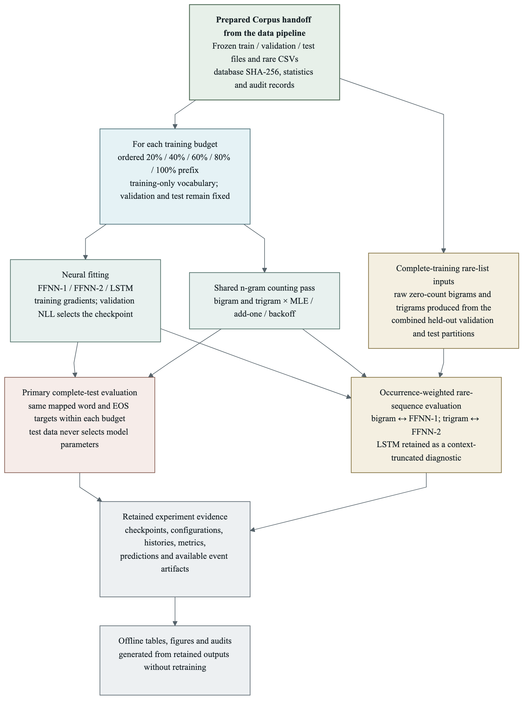

*Figure 2. Frozen six-corpus experimental protocol. Validation selects neural checkpoints, while complete-test scoring and the combined held-out rare-sequence diagnostic remain excluded from parameter fitting.*

We do not compare raw perplexity magnitudes across corpora or run significance tests over dependent token events. Runtime is separated into shared statistical fitting, neural training and evaluation, and is treated descriptively because hardware and selected neural epoch counts differ.

## 6. Results

### 6.1 Complete-training comparison

**Table 2. Complete-training test perplexity.** Neural entries are mean +/- sample SD where three seeds exist. Lower is better; bold marks the corpus minimum.

| Model | Brown | Gutenberg | Inaugural | Reuters | ROCStories | WebText |
| :-- | --: | --: | --: | --: | --: | --: |
| Bigram MLE | infinity | infinity | infinity | infinity | infinity | infinity |
| Trigram MLE | infinity | infinity | infinity | infinity | infinity | infinity |
| Bigram add-one | 1,589.2 | 11,772.1 | 2,958.7 | 5,638.2 | 1,211.0 | 9,927.8 |
| Trigram add-one | 9,641.1 | 52,180.6 | 8,130.0 | 23,001.0 | 6,476.6 | 16,396.3 |
| Bigram backoff | 260.0 | **914.5** | 344.3 | 357.4 | 134.4 | **3,396.7** |
| Trigram backoff | 260.2 | 940.8 | **342.0** | **291.2** | 110.4 | 3,548.8 |
| FFNN, context 1 | 263.2 +/- 0.4 | 1,174.0 +/- 36.6 | 448.8 +/- 3.9 | 502.7 +/- 6.3 | 140.3 | 5,046.4 +/- 243.4 |
| FFNN, context 2 | 246.6 +/- 0.9 | 1,171.2 +/- 41.6 | 422.8 +/- 8.3 | 412.8 +/- 5.0 | 106.8 | 4,976.4 +/- 298.3 |
| LSTM | **206.8 +/- 0.9** | 1,053.9 +/- 2.4 | 387.1 +/- 17.4 | 308.1 +/- 1.0 | **78.2** | 5,369.9 +/- 1,731.4 |

LSTM improves over the best backoff model by 20.5% on Brown and 29.2% on ROCStories. It trails by 15.2%, 13.2%, 5.8% and 58.1% on Gutenberg, Inaugural, Reuters and WebText. ROCStories' context-two FFNN also beats trigram backoff, so neural success is not restricted to the LSTM. WebText has high seed sensitivity: its LSTM PPLs are 4,249.4, 4,496.2 and 7,364.1. These outcomes support corpus-conditional conclusions rather than one universal ranking.

Figure 3 shows that accuracy and perplexity need not rank models identically.

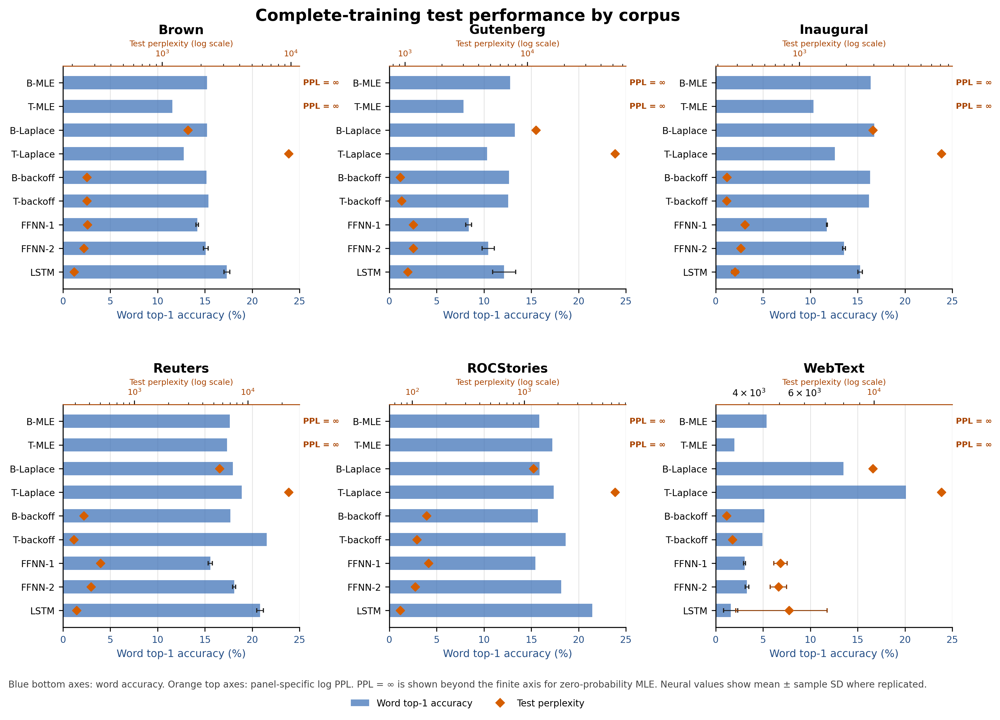

*Figure 3. Complete-training test word top-1 accuracy and perplexity for all nine models, shown separately for each corpus. Blue bars use the lower accuracy axis; orange diamonds use the explicitly labelled panel-specific logarithmic perplexity axis, whose ticks are powers of ten. `PPL = ∞` is printed beyond the finite axis for zero-probability MLE; neural error bars show sample SD where multiple seeds are available.*

### 6.2 Smoothing ablation and zero-probability failure

Both MLE orders have infinite test PPL in all six corpora at complete training. Table 3 shows the underlying event rates and word accuracy. Trigrams encounter more zeros because their histories are more specific.

**Table 3. Complete-training MLE diagnostics.** Zero rates include EOS; accuracy uses word targets.

| Corpus | Bigram zero rate | Bigram accuracy | Trigram zero rate | Trigram accuracy |
| :-- | --: | --: | --: | --: |
| Brown | 24.71% | 15.24% | 63.27% | 11.56% |
| Gutenberg | 41.49% | 12.77% | 79.62% | 7.83% |
| Inaugural | 40.95% | 16.36% | 76.49% | 10.34% |
| Reuters | 29.07% | 17.63% | 60.70% | 17.33% |
| ROCStories | 12.11% | 15.85% | 35.70% | 17.23% |
| WebText | 70.42% | 5.36% | 90.72% | 1.97% |

Add-one removes zeros but spreads one pseudocount over every permitted target. Corresponding-order backoff has about 6-55 times lower PPL across the original three corpora. On revised WebText, add-one is 2.92 times worse than bigram backoff and 4.62 times worse than trigram backoff. Finite support is necessary, but uniform redistribution is not sufficient for good probability allocation.

### 6.3 Rare and unseen sequence performance at complete training

We use two complementary views of sparsity. First, the full test set is partitioned into mutually exclusive event categories while preserving normal sentence context. Second, a restricted probe scores raw zero-count bigram and trigram sequences extracted from the combined held-out validation and test partitions. The restricted lists are occurrence-weighted by held-out frequency and include word-plus-EOS events. They are rare relative to the complete training text: neither held-out partition contributes vocabulary entries, statistical counts or gradient updates, although validation performance selects neural checkpoints.

#### 6.3.1 Full-test event categories

Table 4 decomposes LSTM-minus-backoff NLL. Negative values favor LSTM and rows add to the total. The LSTM advantage on unseen bigrams with retained targets occurs in every corpus, but other categories can reverse the aggregate ranking.

**Table 4. Category contributions to LSTM-minus-backoff NLL, nats per total test event.** Fixed backoff is bigram for Brown, Gutenberg and WebText; trigram elsewhere.

| Category | Brown | Gutenberg | Inaugural | Reuters | ROCStories | WebText |
| :-- | --: | --: | --: | --: | --: | --: |
| Seen trigram | -0.06934 | +0.02797 | +0.13304 | +0.18257 | -0.06731 | +0.05337 |
| Unseen trigram, seen bigram | -0.04864 | +0.10623 | +0.03651 | -0.04131 | -0.14337 | +0.22513 |
| Unseen bigram, retained target | -0.11281 | -0.18319 | -0.22356 | -0.27837 | -0.19584 | -0.10223 |
| OOV target | +0.00192 | +0.19093 | +0.17724 | +0.19332 | +0.06182 | +0.24978 |
| **Total** | **-0.22887** | **+0.14194** | **+0.12323** | **+0.05622** | **-0.34469** | **+0.42605** |

Figure 4 shows how favorable and unfavorable category contributions combine.

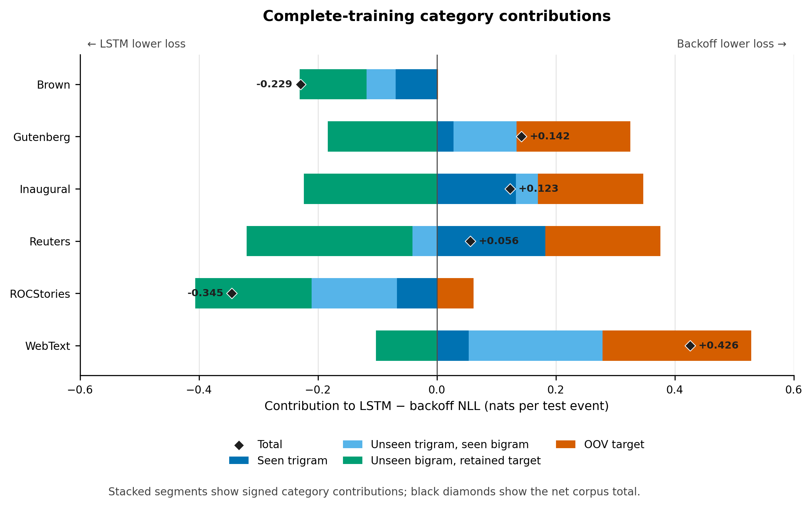

*Figure 4. Additive complete-training contributions to LSTM-minus-backoff NLL. Negative values favor LSTM and positive values favor backoff; black diamonds mark each corpus total. The fixed comparator is bigram backoff for Brown, Gutenberg and WebText, and trigram backoff elsewhere.*

The LSTM reduces conditional PPL for unseen bigrams with retained targets by 37.2%, 43.0%, 46.8%, 67.3%, 82.3% and 20.1% in corpus order. This is evidence of generalization beyond directly observed mapped bigrams, not rare-word mastery. In Gutenberg, Inaugural and Reuters, the non-OOV contribution favors LSTM but the OOV penalty is larger. ROCStories retains a strong total gain because OOV events are only 0.8% of its test events. WebText loses on OOV and combined non-OOV events, so simply removing unknown targets would not make LSTM the winner.

#### 6.3.2 Zero-count n-gram populations

Table 5 reports the restricted rare-list probe. Bigram models and FFNN-1 receive one-token histories; trigram models and FFNN-2 receive two-token histories. The LSTM is shown only as a context-truncated diagnostic because it receives the stored n-gram history rather than its usual complete sentence prefix. Bigram and trigram panels contain different held-out events, so their absolute PPL values should not be compared directly. Neural entries are mean +/- sample SD where three seeds exist; ROCStories is single-seed.

**Table 5. Occurrence-weighted complete-training perplexity on raw zero-count held-out sequences. Lower is better.**

**Panel A: zero-count bigrams.**

| Model | Brown | Gutenberg | Inaugural | Reuters | ROCStories | WebText |
| :-- | --: | --: | --: | --: | --: | --: |
| Bigram MLE | infinity | infinity | infinity | infinity | infinity | infinity |
| Bigram add-one | 8,290.2 | 82,314.9 | 12,739.1 | 58,880.0 | 66,301.4 | 20,054.4 |
| Bigram backoff | 3,037.0 | 19,913.5 | **5,085.2** | **26,234.3** | 39,718.9 | **17,792.7** |
| FFNN, context 1 | **2,587.1 +/- 128.3** | **18,204.7 +/- 1,238.7** | 5,148.9 +/- 120.6 | 40,912.5 +/- 2,229.2 | **38,370.5** | 23,512.7 +/- 945.2 |
| LSTM, truncated context | 3,788.0 +/- 313.1 | 38,882.8 +/- 8,701.8 | 8,812.2 +/- 1,505.4 | 80,744.6 +/- 12,756.5 | 54,667.3 | 21,173.6 +/- 6,452.9 |

**Panel B: zero-count trigrams.**

| Model | Brown | Gutenberg | Inaugural | Reuters | ROCStories | WebText |
| :-- | --: | --: | --: | --: | --: | --: |
| Trigram MLE | infinity | infinity | infinity | infinity | infinity | infinity |
| Trigram add-one | 18,117.4 | 77,247.1 | 12,177.6 | 56,301.3 | 59,048.6 | 19,420.6 |
| Trigram backoff | 710.0 | **2,320.3** | **828.5** | **1,788.8** | 1,398.6 | **4,991.2** |
| FFNN, context 2 | **587.0 +/- 8.0** | 2,577.3 +/- 103.4 | 899.9 +/- 32.3 | 2,079.8 +/- 60.7 | **1,076.5** | 6,918.7 +/- 417.2 |
| LSTM, truncated context | 675.6 +/- 28.9 | 2,766.0 +/- 136.8 | 1,087.4 +/- 85.3 | 2,887.6 +/- 110.6 | 1,312.9 | 7,295.3 +/- 2,037.0 |

MLE is infinite throughout because every listed target sequence has zero raw training count. Add-one makes all results finite but trails backoff in every corpus and order. Among the context-matched comparisons, FFNN-1 leads on Brown, Gutenberg and ROCStories bigrams, while FFNN-2 leads on Brown and ROCStories trigrams; backoff leads the remaining populations. Thus parameter sharing helps on some zero-count sequences, but lower-order count evidence remains stronger in several corpora. We deemphasize rare-list accuracy because raw rare words can map to the shared `<unk>` label and create apparently correct predictions without recovering their original spellings.

#### 6.3.3 Representative successes and failures

Table 6 gives ten representative cases from the complete-training event exports. Values are natural-log target probabilities; larger values assign more probability. Cases are diagnostic rather than a random estimate of prevalence.

**Table 6. Representative rare or unseen predictions.** BO denotes trigram backoff unless the interpretation states otherwise.

| Corpus and sequence | Evidence and scores | Interpretation |
| :-- | :-- | :-- |
| Brown: `vary according -> to` | Trigram unseen; `according to` count 103; BO -0.05, add-one -10.10 | Strong shorter-context evidence makes backoff decisive. |
| Brown: `comparable -> basis` | Bigram unseen; target count 158; LSTM -1.67, BO -9.40 | Neural prediction succeeds without direct bigram evidence. |
| Gutenberg: `lead among -> you.` | Final bigram unseen; target count 179; LSTM -5.25, BO -10.30 | A retained target benefits from neural generalization beyond the direct count. |
| Gutenberg: `my lord -> esau:` | Target OOV; LSTM -22.96, BO -16.07 | Both score the common unknown symbol, not recovery of the name. |
| Gutenberg: `frank churchill was one of the -> boasts` | Singleton target; LSTM -13.49, FFNN-2 -13.91, BO -14.51, add-one -11.30 | Parameter sharing does not solve every rare target. |
| Inaugural: `important branch -> of` | Trigram unseen; final bigram count 8; BO -0.10, add-one -9.40 | Modest lower-order evidence can dominate uniform smoothing. |
| Inaugural: `be duly -> appreciated` | Target OOV; LSTM -19.25, BO -11.66 | No positive `<unk>` targets makes the neural unknown score very small. |
| Reuters: `in 1985's 4th -> qtr.` | Final bigram unseen; target count 9; LSTM -5.90, FFNN-2 -10.79, BO -15.93 | Longer financial sentence context supports a neural gain. |
| ROCStories: `he had lost 5 -> pounds.` | Bigram unseen; target count 106; LSTM -0.31, FFNN-2 -3.45, BO -12.01 | Strong within-sentence contextual prediction; state does not cross story sentences. |
| WebText: `against each -> other` | Trigram unseen; `each other` count 6; BO -1.34, LSTM mean -7.69, add-one -9.82 | Familiar shorter phrase remains valuable under source shift. |

Section 7 synthesizes the category decomposition, restricted PPL results and qualitative cases.

### 6.4 Accuracy and unknown-label inflation

Accuracy and PPL rank different properties. Inaugural bigram add-one reaches 16.76% word accuracy despite PPL 2,958.7, because probability assigned below the top prediction still affects PPL.

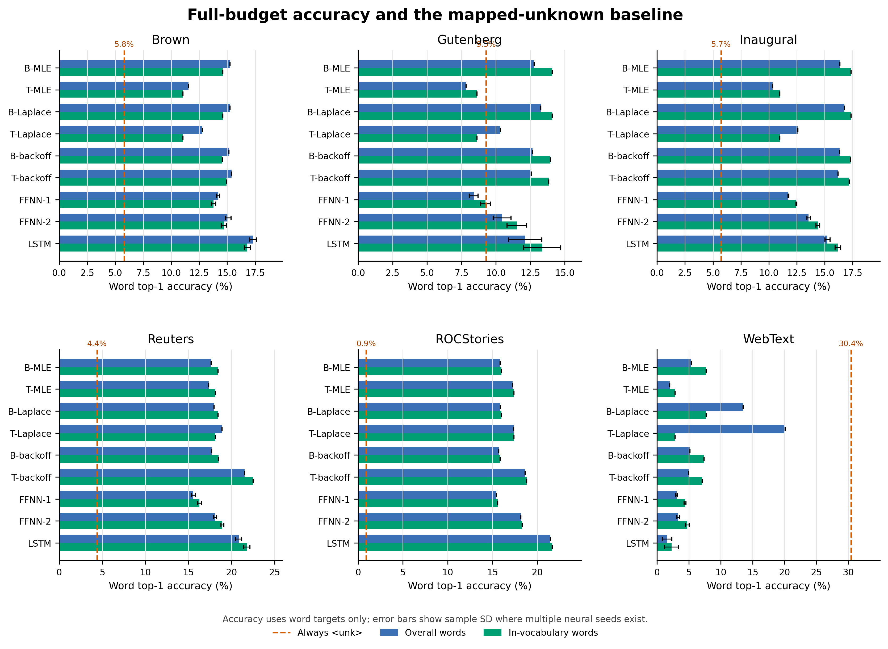

*Figure 5. Complete-training word top-1 accuracy. Blue bars include mapped unknown targets; green bars retain only in-vocabulary targets. Dashed lines show always predicting `<unk>`. Error bars show sample SD for replicated neural models.*

WebText makes the artifact explicit. Its 12,818 OOV words are 30.42% of the test words. Trigram add-one reports 20.09% overall accuracy, but 7,637 of its 8,467 correct predictions are `<unk>` targets; retained-word accuracy is only 2.83%. Bigram add-one falls from 13.50% overall to 7.71% retained-word accuracy. All of add-one's raw accuracy gain over corresponding MLE is explained by additional `<unk>`-to-`<unk>` matches. Smoothing improved the mapped-label score, not lexical recovery.

### 6.5 Training-percentage experiment

**Table 7. Best neural PPL divided by best backoff PPL by training percentage.** Values below one favor neural prediction. ROCStories is single-seed. WebText's neural winner changes across percentages.

| Corpus | 20% | 40% | 60% | 80% | 100% |
| :-- | --: | --: | --: | --: | --: |
| Brown | 0.859 | 0.833 | 0.808 | 0.800 | 0.795 |
| Gutenberg | 1.201 | 1.182 | 1.133 | 1.129 | 1.153 |
| Inaugural | 1.323 | 1.220 | 1.186 | 1.146 | 1.132 |
| Reuters | 1.298 | 1.181 | 1.118 | 1.108 | 1.058 |
| ROCStories | 0.832 | 0.776 | 0.728 | 0.710 | 0.708 |
| WebText | 1.296 | 1.209 | 1.295 | 1.355 | 1.465 |

Relative neural performance improves from the smallest to largest budget in five corpora, but not WebText. Gutenberg also worsens from 80% to 100%. Reuters narrows its LSTM deficit without crossing backoff; ROCStories favors LSTM throughout. Brown's absolute LSTM PPL rises from 164.5 to 206.8 while its relative advantage grows, illustrating why changing vocabulary and composition prevent a simple learning-curve interpretation.

Figure 6 records the changing prediction support behind this ablation. Vocabulary is rebuilt at each ordered budget, so both the number of available output types and the proportion of held-out words mapped to `<unk>` change with percentage. Token inventories differ across corpora; raw cross-corpus PPL magnitudes are therefore not on a common lexical scale.

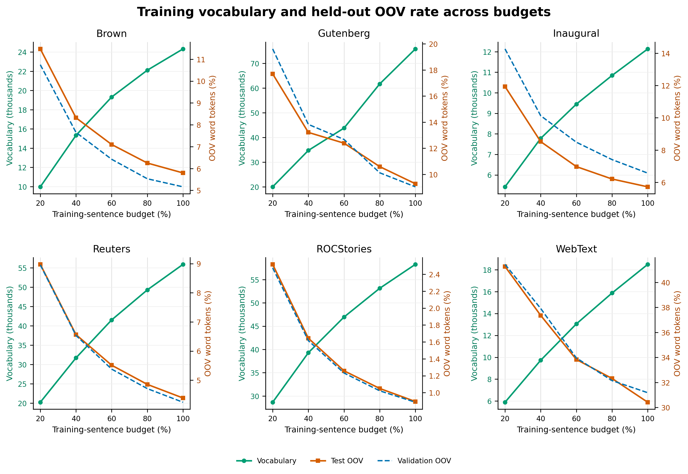

*Figure 6. Training vocabulary and validation/test word OOV rates across ordered sentence budgets.*

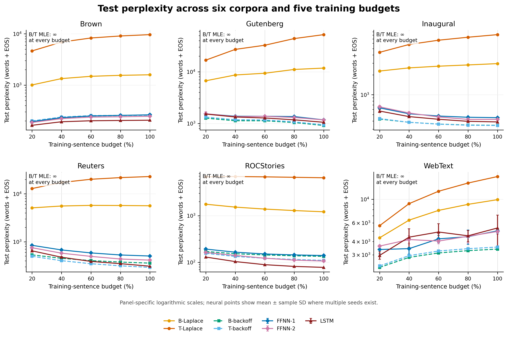

*Figure 7. Test perplexity across five ordered sentence budgets. Panel-specific logarithmic axes are used; both MLE models are infinite at every budget and are noted rather than drawn.*

On fixed cohorts of target occurrences retained under the 20% vocabulary, including EOS, both backoff and LSTM improve from 20% to 100% for all six corpora. WebText LSTM improves from 399.7 +/- 37.4 to 333.1 +/- 21.3, but bigram backoff improves from 312.4 to 270.3; the ranking does not reverse. Gutenberg's full-budget cohort mean crosses slightly below backoff, but the 10.8-point difference is smaller than its 13.1 sample SD. Fixed membership clarifies support effects without producing a causal data threshold.

The Brown sequence `peanut and sesame -> oils` illustrates the mapping complication. At 20%, the target maps to `<unk>` and receives LSTM log probability -2.21; at 100%, `oils` is retained as its own target and receives -20.03. The two scores do not describe forgetting of one fixed label because the prediction task changed with the vocabulary.

## 7. Discussion

The three evaluation tracks point to the same conditional account. Unsmoothed MLE fails whenever a held-out event has zero probability. Add-one restores finite support but usually allocates probability less effectively than backoff. Backoff is strongest when a missing higher-order sequence has a familiar shorter continuation, whereas the context-matched FFNNs can improve some retained targets without direct sequence counts. The LSTM's longer sentence prefix provides the largest gains on Brown and ROCStories but does not overcome lexical and source-shift penalties everywhere.

These findings also explain why a single accuracy or perplexity ranking is insufficient. PPL evaluates the full target distribution, top-1 accuracy can be inflated by mapped `<unk>` matches, and the restricted rare lists remove the LSTM's normal context. The complete test, event-category decomposition and zero-count probes therefore answer related but distinct questions; agreement across them is stronger evidence than any one score.

## 8. Limitations, Ethics and Reproducibility

One document split and one ordered budget sequence are used per corpus. Genre, source, author and era can change with percentage, and prefix endpoints may fall inside documents. ROCStories has only one neural seed. WebText has exact short cross-split repetitions, high OOV and strong source shift. Two Gutenberg books and two WebText source files do not provide broad test coverage. These conditions prevent population-level significance or universal crossover claims.

The vocabulary changes at every budget. Fixed cohorts hold target occurrences constant but not model capacity, output support or mapped histories. FFNN and statistical histories are length-matched, but their representations and boundary encoding differ. LSTM uses longer context and more parameters. Fixed hyperparameters, $d=0.75$, add-one smoothing and the absence of Kneser-Ney, subword tokenization or pretrained baselines limit claims about the best possible method. No pretrained language model or paid/external inference API was used: training and evaluation are implemented locally with Python, PyTorch and NLTK, while `torchinfo` is used only to print pre-training architecture summaries for Appendix A evidence.

The corpora contain historical language, news, crowdsourced stories and informal web content with social biases and potentially identifiable people. WebText includes personal advertisements. Public availability does not guarantee unrestricted redistribution. Appendix E records acquisition dates, exact package or repository snapshots and the terms available from NLTK or the original project. Brown is restricted to non-commercial use and Reuters to research use. **TBD — licensing verification:** Confirm the upstream redistribution terms for WebText and ROCStories; until resolved, do not redistribute their raw text as project artifacts. No new participant data were collected.

Run configurations, percentage-specific training texts, vocabularies, checkpoints, histories, metrics and prediction exports preserve the primary evidence. Result bundles contain 420 test conditions: 360 finite smoothed/neural conditions and 60 infinite MLE conditions. The revised WebText metrics contain all expected rows and its three-seed word-accuracy groups were reconstructed by retained/OOV target. However, the local revised WebText bundle lacks the per-event scoring archive needed to recompute every event-category view directly. Figure 4 is therefore regenerated from the corrected aggregate contributions retained in Table 4, not by event rescoring. Existing comparison code can rescore saved checkpoints without retraining, but the separate historical event-export script referenced by the working paper is not present and must not be presented as an executable reproduction command.

Runtime measurements are not hardware normalized. Brown ran on Colab, while other fits include Kubeflow execution or recovery. The architecture screenshots in Appendix A demonstrate model structure, not the original training device. The current training path prints the same layer-by-layer summary immediately before fitting and outside the measured training interval, allowing this evidence to be captured directly from a reproduced run.

## 9. Conclusion

Smoothing fixes the catastrophic zero-probability failure of unsmoothed n-grams, but the method used to allocate probability matters. Add-one is finite yet often poorly calibrated, and its mapped-unknown matches can inflate accuracy. Absolute-discount backoff leads the complete test sets of Gutenberg, Inaugural, Reuters and WebText; LSTM leads Brown and ROCStories. Neural models show their most consistent advantage on retained targets after unseen bigram contexts, whereas OOV losses reverse non-OOV gains in several corpora.

The ordered-budget experiment does not establish a universal neural crossover. Relative neural performance improves at the endpoints in five corpora but remains corpus-dependent. The evidence supports a conditional conclusion: backoff is strong when shorter-context counts transfer well, while neural recurrence helps when useful sentence context remains despite missing local sequences. Stronger count baselines, fixed-support and tokenizer ablations, multiple split orders, additional ROCStories seeds and a leakage-clean WebText design are required before generalizing beyond these observed corpora.

## Author Contributions

**TBD before submission:** Replace this note with the final group-approved contribution statement, covering problem formulation, data preparation, implementation, experiment execution, analysis, visualization, writing and verification.

| Member | Contribution |
| :-- | :-- |
| Akshaya Kumar Joish (`2025cs05013`) | Neural model development,  collecting resuts and writing Research paper |
| Anuj Kumar Srivastava (`2025cs05040`) | Statistical model development, collecting results/evidence and writing research paper |
| Murali Das Mohan (`2025cs05052`) | Data pipeline and orchestration development, corpus pre-analysis and writing research paper |
| **TBD: fourth member identity** | **TBD: confirm the group- and instructor-approved contribution wording.** |

**TBD before submission:** Confirm that all four authors reviewed the manuscript, approved the contribution statement and accept responsibility for the submitted work.

## AI-Use Declaration

**TBD before submission:** Review and approve the final AI-use wording as a group.

AI agents were extensively used for this research.
- Help with articulating the problem and identifying work-able task breakups
- Goal based code generation - not as a whole run to completion, but stage by stage short functions/snippets/files
- Review of run data, identifying discrepencies in results
- Help with preparation of paper skeleton and structure.
- Inserting/validating  data into the relevant tables and numnerical figures in the research
- Evaluating the paper based on assignment goals


## References

1. Katz, S. M. 1987. Estimation of probabilities from sparse data for the language model component of a speech recognizer. *IEEE Transactions on Acoustics, Speech, and Signal Processing*, 35(3):400-401.
2. Chen, S. F., and Goodman, J. 1996. [An Empirical Study of Smoothing Techniques for Language Modeling](https://aclanthology.org/P96-1041/). *Proceedings of ACL*, 310-318.
3. Bengio, Y., Ducharme, R., Vincent, P., and Jauvin, C. 2003. [A Neural Probabilistic Language Model](https://www.jmlr.org/papers/v3/bengio03a.html). *Journal of Machine Learning Research*, 3:1137-1155.
4. Hochreiter, S., and Schmidhuber, J. 1997. Long short-term memory. *Neural Computation*, 9(8):1735-1780.
5. Banko, M., and Brill, E. 2001. [Scaling to Very Very Large Corpora for Natural Language Disambiguation](https://aclanthology.org/P01-1005/). *Proceedings of ACL*, 26-33.
6. Bird, S., Klein, E., and Loper, E. 2009. [Natural Language Processing with Python](https://www.nltk.org/book/). O'Reilly Media.
7. Kneser, R., and Ney, H. 1995. Improved backing-off for M-gram language modeling. *Proceedings of ICASSP*, 181-184.
8. Gebru, T., Morgenstern, J., Vecchione, B., Vaughan, J. W., Wallach, H., Daume III, H., and Crawford, K. 2021. Datasheets for datasets. *Communications of the ACM*, 64(12):86-92.
9. Warstadt, A., et al. 2023. [Findings of the BabyLM Challenge](https://aclanthology.org/2023.conll-babylm.1/). *Proceedings of the BabyLM Challenge at CoNLL*, 1-34.
10. Hu, M. Y., et al. 2024. [Findings of the Second BabyLM Challenge](https://aclanthology.org/2024.conll-babylm.1/). *Proceedings of the Second BabyLM Challenge*, 1-21.
11. Khandelwal, U., Levy, O., Jurafsky, D., Zettlemoyer, L., and Lewis, M. 2020. [Generalization through Memorization: Nearest Neighbor Language Models](https://arxiv.org/abs/1911.00172). *ICLR*.
12. Hoffmann, J., et al. 2022. [An Empirical Analysis of Compute-Optimal Large Language Model Training](https://proceedings.neurips.cc/paper_files/paper/2022/hash/c1e2faff6f588870935f114ebe04a3e5-Abstract-Conference.html). *NeurIPS*, 35.
13. Liu, J., Min, S., Zettlemoyer, L., Choi, Y., and Hajishirzi, H. 2024. [Infini-gram: Scaling Unbounded n-gram Language Models to a Trillion Tokens](https://arxiv.org/abs/2401.17377). *Conference on Language Modeling*.
14. Xue, L., et al. 2022. [ByT5: Towards a Token-Free Future with Pre-trained Byte-to-Byte Models](https://aclanthology.org/2022.tacl-1.17/). *Transactions of the ACL*, 10:291-306.
15. Papusoi, R., and Nisioi, S. 2025. [A Comparison of Elementary Baselines for BabyLM](https://aclanthology.org/2025.babylm-main.16/). *Proceedings of the First BabyLM Workshop*, 218-225.
16. Choshen, L., et al. 2026. [Findings of the Fourth BabyLM Challenge and Workshop: Going Beyond English](https://aclanthology.org/2026.babylm-main.37/). *Proceedings of the Second BabyLM Workshop*, 479-492.
17. Hwang, J., Edman, L., and Fraser, A. 2026. [Language Exposure Matters: Distribution and Order in Multilingual BabyLM Pre-training](https://aclanthology.org/2026.babylm-main.69/). *Proceedings of the Second BabyLM Workshop*, 904-911.

## Appendix A. Saved Neural Architecture Evidence

The following `torchinfo` summaries use the actual Inaugural complete-training, seed-13 vocabulary and model configurations. The training path now emits the same architecture table immediately before `Trainer.fit`, before any optimizer step. The displayed batch contains 32 sequences of length 10 only to exercise the model summary; it does **not** redefine the FFNN history length. FFNN context one still predicts from one preceding token and context two from two. The summary restores model mode and random-number state after inspection, and automatically reduces the inspection shape for larger vocabularies.

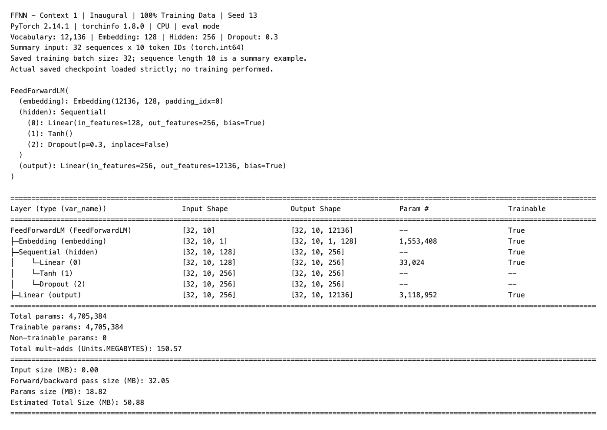

*Figure A1. FFNN context one: vocabulary 12,136; embedding 128; hidden 256; dropout 0.3; 4,705,384 trainable parameters.*

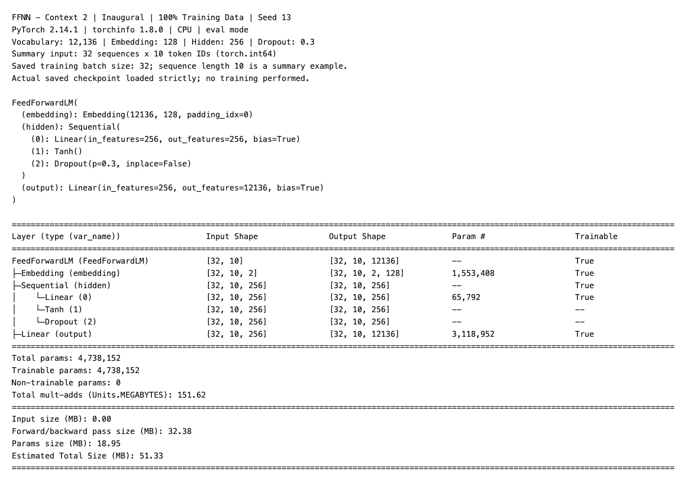

*Figure A2. FFNN context two: the additional input embedding block increases the hidden projection; 4,738,152 trainable parameters.*

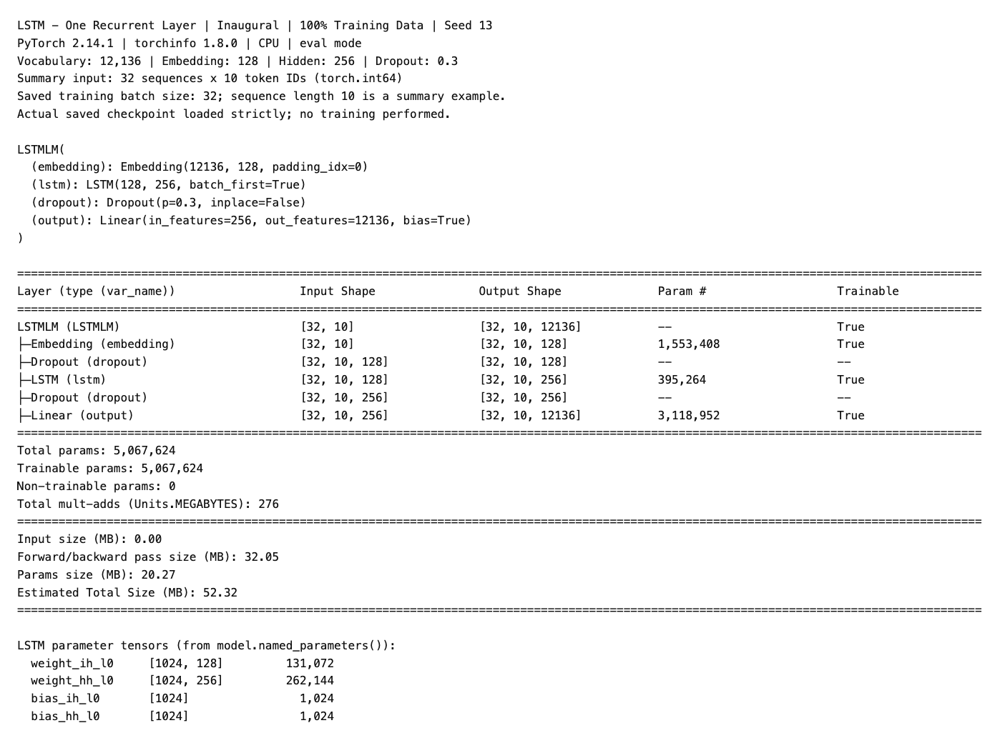

*Figure A3. One-layer sentence-level LSTM: embedding 128; hidden 256; dropout 0.3; 5,067,624 trainable parameters.*

## Appendix B. Recorded Runtime

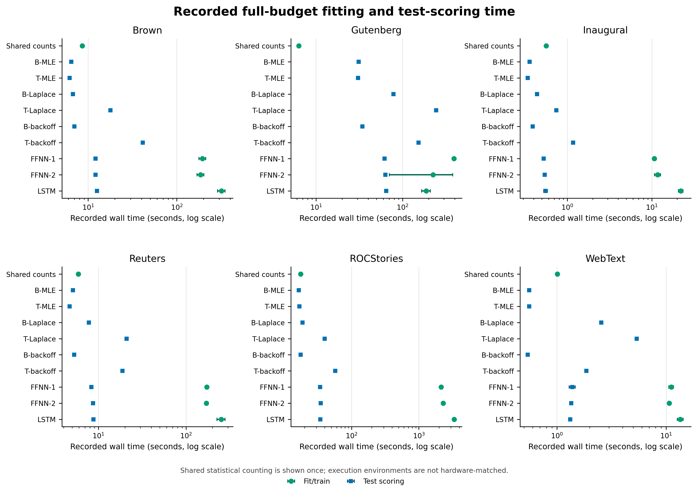

*Figure B1. Complete-training fitting and test-scoring wall time. Statistical variants share one counting pass. Neural points summarize seeds where replicated. Environments and selected epochs differ, so the figure is descriptive rather than a hardware-normalized efficiency comparison.*

Complete-training shared count-fit/LSTM-train times in seconds are: Brown 8.6/318.8; Gutenberg 6.3/187.7; Inaugural 0.6/22.1; Reuters 5.9/251.9; ROCStories 17.5/3,346.8; and WebText 1.0/13.5. Neural training is materially more expensive, but the cost-to-PPL trade-off is corpus-dependent.

## Appendix C. Four Additional Diagnostic Cases

Together with the training-budget mapping case in Section 6.5, these cases supplement the ten cases in Table 6 and bring the qualitative audit to fifteen distinct sequences.

1. **Inaugural: `partiality has -> bestowed`**. The target appears four times and the bigram is unseen. LSTM improves from backoff -11.28 to -7.24, but the event remains difficult.
2. **Brown: `for god's -> sake`**. The trigram grows from zero to seven. LSTM improves from -13.57 to -0.17; complete-training backoff reaches -0.11.
3. **Inaugural: `mr. vice -> president,`**. The trigram grows from zero to four. LSTM improves from -10.90 to -4.62, while backoff reaches -0.21.
4. **Gutenberg: `o my -> lord,`**. The trigram grows from zero to one and target count from one to 134. LSTM improves from -11.87 to -3.67, close to backoff -3.69.

## Appendix D. Reproduction and Submission Notes

The current repository supports the following read-only completeness checks and compact plot regeneration:

```bash
python src/run.py --full src/configs/mega-run.yaml --check
python src/model_comparison.py <corpus> --check
python src/plot_paper.py --results-root results --output-dir docs/figures
```

The complete experiment is expensive; the resumable orchestration entry point is:

```bash
python src/run.py --full src/configs/mega-run.yaml --resume
```

The historical command `src/analyze_comparison_sweep.py --events` is not included in the current repository and must not be presented as executable. Regenerating a missing `scoring_events.jsonl.gz` requires a new event sink and rescoring saved checkpoints; it does not require neural retraining.

**TBD — reproducibility decision:** Either regenerate and retain the revised WebText per-event archive using a new event sink, or approve Figure 4's corrected aggregate-only reproduction and retain the limitation disclosed in Section 8.

### TBD before submission

- fourth member name and student ID;
- institution/instructor/submission-date wording required by the template;
- group approval of the contribution and AI-use statements;
- upstream licence verification for WebText and ROCStories;
- recovery of the exact ROCStories mirror revision, or approval of the processed-snapshot limitation;
- a consolidated record of recoverable Python, PyTorch, accelerator and execution-environment metadata;
- final artifact hashes and a page-by-page PDF render check;
- verification of all cited source line numbers against the frozen submission revision.

## Appendix E. Dataset Provenance and Licensing

The local NLTK archives are dated 19 October 2026; ROCStories has a recorded acquisition date of 25 October 2026. NLTK 3.10.3 was the downloader/runtime version. The NLTK library version is not a corpus version: Brown, Gutenberg, Inaugural, Reuters and WebText have no `version` attribute in the [official NLTK package index](https://github.com/nltk/nltk_data/blob/gh-pages/index.xml). The archive hashes below therefore identify the package snapshots more precisely than the library version alone. They were recomputed from the local archives and matched the SHA-256 values in the official index on 8 November 2026.

| Corpus | Package or upstream revision | Acquisition date |
| :-- | :-- | :-- |
| Brown | NLTK package `brown`; archive SHA-256 below | 19 October 2026 |
| Gutenberg | NLTK package `gutenberg`; archive SHA-256 below | 19 October 2026 |
| Inaugural | NLTK package `inaugural`; archive SHA-256 below | 19 October 2026 |
| Reuters | NLTK package `reuters`, Reuters-21578 ApteMod/Distribution 1.0; archive SHA-256 below | 19 October 2026 |
| ROCStories | `mintujupally/ROCStories` mirror; **TBD:** recover or document the exact downloaded revision; processed snapshot SHA-256 below | 25 October 2026 |
| WebText | NLTK package `webtext`; archive SHA-256 below | 19 October 2026 |

```text
brown     9b275f9b3b95d7bd66ccfb7cd259f445a13bbe5d1f4107aba09fd3e8364bafa6
gutenberg 2d3c3ab548c653944310f37f536443ec85d0a0ad855fcae217a0c9efdce2d611
inaugural b3b2cb7bd82697b58ff79c75af20ab963810d191a8c3d1f7c240f98e5d27a895
reuters   9a59a43823f02a6e2777075c989a3dc454e4b6f68e0332ee3c0e8264075b62f5
webtext   9e32dbae4879464b8f420a0dc721855bb26167b720d7695588d2ca2aeadf501a
```

**TBD — ROCStories provenance:** Attempt to recover the source archive or exact mirror revision. If it remains unavailable at submission, retain the following processed-training SHA-256 as the experiment identifier and state the limitation explicitly: `fbc3987bf268083794ace03146a1c59d8f89bdddfe8a29ebfe1cd867461cfc63`.

The `nltk_data` repository's Apache-2.0 license does not replace the terms attached to individual packages, as the [NLTK license overview](https://github.com/nltk/nltk_data/blob/gh-pages/LICENSE-OVERVIEW.md) makes explicit. The following wording records the available metadata and the resulting redistribution decision; it is not legal advice.

| Corpus | Recorded terms and redistribution decision |
| :-- | :-- |
| Brown | NLTK package metadata states: “May be used for non-commercial purposes.” This work is academic and non-commercial; the raw package should not be redistributed for commercial use. |
| Gutenberg | NLTK marks its packaged Project Gutenberg selections as public domain. Because status can depend on the work and jurisdiction, this claim is limited to NLTK's package metadata. |
| Inaugural | NLTK marks the C-SPAN Inaugural Address Corpus as public domain. |
| Reuters | Reuters Ltd. retains copyright in the articles and annotations. NLTK records permission for free distribution for research purposes only and requests acknowledgement as “Reuters-21578, Distribution 1.0”; raw redistribution should remain within those terms. |
| ROCStories | **TBD — verify upstream licence.** The [original project page](https://www.cs.rochester.edu/nlp/rocstories/) offers free access through a request form, but the applicable redistribution terms have not yet been confirmed. Until resolved, do not redistribute the raw text. |
| WebText | **TBD — verify upstream licence.** The package has no licence attribute and appears in NLTK's [unclarified or missing-license group](https://github.com/nltk/nltk_data/blob/gh-pages/DATASET-LICENSES.md). Until resolved, do not redistribute the raw text. |

## Appendix F. Figure Reproduction Map

Cross-corpus quantitative figures are regenerated from retained result artifacts and the corrected Table 4 aggregates without model fitting, inference or metric rescoring. The complete command is:

```bash
python src/plot_paper.py \
  --results-root results \
  --output-dir docs/figures \
  --plots complete-training event-categories test-perplexity vocabulary-oov accuracy runtime \
  --tag <publication-tag>
```

To regenerate only the primary complete-training visual, use `--plots complete-training`; use `--plots event-categories` for the corrected Table 4 contribution plot. Each invocation writes PNG and vector-PDF outputs plus `paper_plot_data_<publication-tag>.json`, which records the selected functions, input paths, output paths and plotted aggregates. Artifact-family names are used below so timestamped publication tags do not affect the mapping.

| Plot artifact or visual | Generator | Retained inputs |
| :-- | :-- | :-- |
| Preprocessing workflow (Figure 1) | Mermaid source embedded in `docs/Paper_Final_Draft.md`; rendered with the paper | Paper source; no data execution |
| `frozen_pipeline.png` (Figure 2) | Mermaid source in `docs/figures/frozen_pipeline.md`; rendered with Mermaid CLI | Frozen splits, rare CSVs, training/evaluation protocol and retained evidence; no data execution |
| `paper_complete_training_*` (Figure 3) | `src/plot_paper.py::plot_complete_training` | Six authoritative `metrics/metrics.csv` files; 100%-budget test rows for all nine models |
| `paper_event_categories_*` (Figure 4) | `src/plot_paper.py::plot_event_category_contributions` | Corrected complete-training aggregate contributions retained in Table 4 and the generator; no event rescoring |
| `paper_accuracy_*` (Figure 5) | `src/plot_paper.py::plot_accuracy` | Six `metrics/metrics.csv` files and six streamed `predictions_correct.csv` exports |
| `paper_vocabulary_oov_*` (Figure 6) | `src/plot_paper.py::plot_vocabulary_oov` | Thirty `train_<percent>pct/data_stats.json` files |
| `paper_test_perplexity_*` (Figure 7) | `src/plot_paper.py::plot_test_perplexity` | Six `metrics/metrics.csv` files; all five budgets |
| `paper_runtime_*` | `src/plot_paper.py::plot_runtime` | Six `metrics/metrics.csv` files and available `train_100pct/runs.csv` files |
| `ffnn_ctx1.png`, `ffnn_ctx2.png`, `lstm.png` (Figures A1-A3) | Runtime `torchinfo` output invoked by `LanguageModelController.run` at `src/lm/controller.py:160`; implementation at `src/lm/neural/trainer.py:59` (`Trainer.print_model_summary`) | Inaugural complete-training, seed-13 vocabulary and model configurations; deterministic inspection input, no optimizer step |

The authoritative result folders are `brown_press_neural`, `gutenberg_neural`, `inaugural_neural`, `reuters_neural`, `roc-stories` and `webtext-nn` under `results/`. Figures A1-A3 were retained from the earlier strict checkpoint inspection, whose architecture table is equivalent to the new pre-training output because fitting does not alter model structure. A reproduced run now prints that table before the training timer and `Trainer.fit`, so a fresh runtime screenshot requires no separate generator script. **TBD — final revision check:** Verify every cited source line number after the manuscript and code are frozen.
